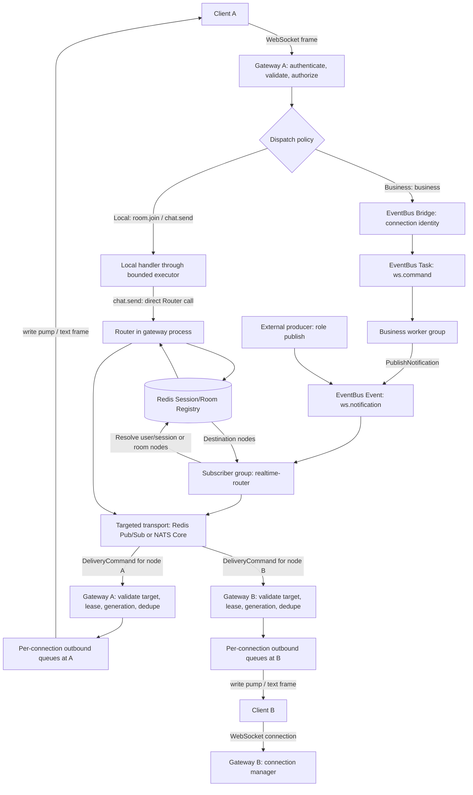
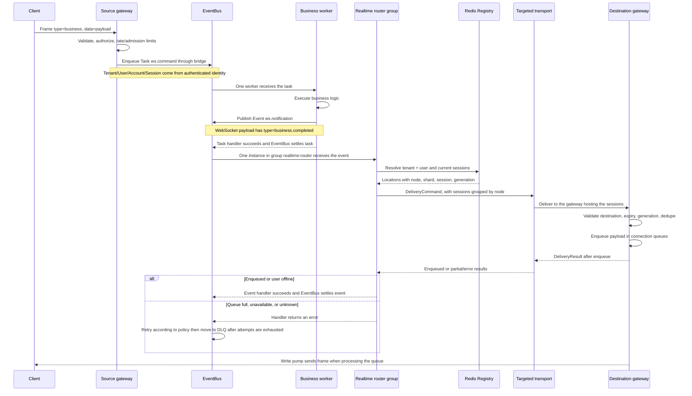
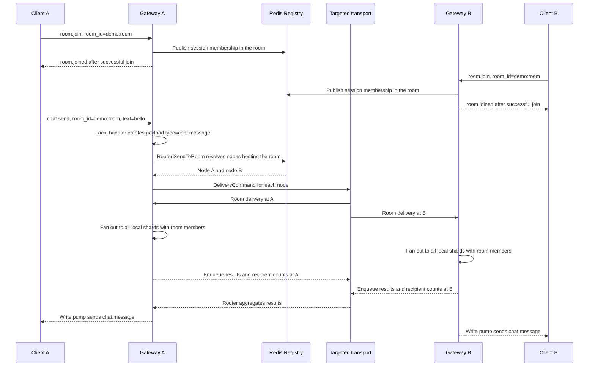
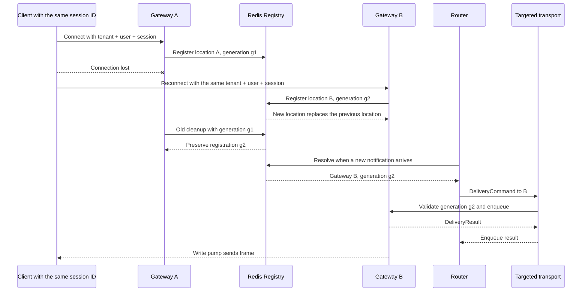
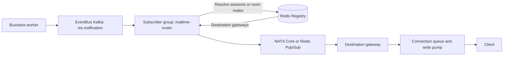

# Gateway / worker / router example

## WebSocket module capabilities

| Capability | Behavior |
|---|---|
| WebSocket connections | Adapters support net/http, Gin, Echo, and Fiber. This cluster example uses net/http. |
| Connection management | The manager assigns connections to shards and manages read/write pumps, ping/pong, timeouts, and shutdown. |
| Identity and resource limits | Supports authentication, authorization, quotas, rate limits, bounded queues, and configurable slow-consumer disconnection. |
| Local messaging | Sends to a connection, user, or room, or broadcasts within a shard. A user can have multiple sessions/devices. |
| Cluster messaging | The router delivers to a user, a specific session, or a room across shards/nodes. The new routing APIs isolate targets by tenant. |
| Session tracking | Redis stores locations, lease TTLs, and generations. Reconnecting with the same session ID updates the destination gateway. |
| Client event dispatch | `Dispatch: Local` runs callbacks through a bounded executor. `Dispatch: Business` publishes commands through the EventBus bridge. |
| Operations | Provides readiness, counters, queue-wait metrics, benchmarks, and enqueue-latency sampling tools. |

The module supports standalone operation, legacy Redis/NATS pub/sub, and opt-in
targeted routing through `ManagerConfig.Distributed`. In distributed mode, the
manager substitutes a noop legacy pub/sub backend to avoid duplicate publication
paths. Applications use the Router for cross-node messaging. Local shard APIs
retain their shard-scoped behavior.

### How WebSocket and EventBus work together

WebSocket maintains connections and places outgoing data into connection queues.
EventBus transports business commands/events, distributes work among worker/router
instances, and handles retry/DLQ behavior. The Redis registry identifies the nodes
hosting a session or room; targeted transport delivers messages to those nodes.

| Component / example role | Responsibility |
|---|---|
| `gateway` | Authenticates clients, manages connections/shards/rooms, registers sessions, runs local handlers or publishes business commands, enqueues payloads, and writes socket frames. |
| `worker` | Instances compete for Task `ws.command`, execute business logic, and publish Event `ws.notification`. |
| `router` | Instances share subscriber group `realtime-router`, divide Event `ws.notification` processing, resolve locations, and deliver to destination gateways. |
| `publish` | An external producer that publishes user or room notifications through EventBus. |
| `load` | Calls the Router directly to measure the round trip to gateway enqueue. It bypasses business Tasks/Events. |

| EventBus driver | Delivery driver | Business Task/Event | Targeted delivery + result | Registry |
|---|---|---|---|---|
| `redis` | `redis` | Redis Streams | Redis Pub/Sub | Redis |
| `redis` | `nats` | Redis Streams | NATS Core | Redis |
| `nats` | `redis` | NATS JetStream | Redis Pub/Sub | Redis |
| `nats` | `nats` | NATS JetStream | NATS Core | Redis |
| `kafka` | `redis` | Kafka | Redis Pub/Sub | Redis |
| `kafka` | `nats` | Kafka | NATS Core | Redis |

Select drivers independently with `-eventbus-driver` and `-delivery-driver`.
The legacy `-broker redis` / `-broker nats` shorthand still supplies the default
for either driver when its explicit flag is omitted. Kafka is an EventBus
backend, not a WebSocket delivery backend.

Each gateway uses two fixed delivery/result subscriptions per node incarnation,
independent of connection count. Gateways, workers, and routers connect to the
broker. Gateways do not establish WebSocket connections to each other.

## Overall flow



The arrows to A/B illustrate possible destinations. User/session delivery targets
only nodes hosting the resolved sessions; room delivery targets nodes with room
membership. Notifications are not broadcast to every node. `room.join` updates
local/Redis membership and returns `room.joined` directly through the connection
queue, without EventBus.

## Business flow: client → worker → notification → client



The destination gateway may be the source gateway or a different node after
reconnect. Once EventBus accepts a task, the worker continues processing it even
if the client disconnects. This example echoes the business payload. Applications
replace that handler with business logic and manage DB transactions/outboxes
where required.

The EventBus event in this example is **`ws.notification`**. `business.completed`
is the `type` field in the frame sent to the client. Custom business events such
as `order.completed` can be integrated through `bridge.Mapping`; this example
does not register such a mapping.

## Chat room flow: local handler → room across shards/nodes



In this example, `chat.send` uses targeted transport directly. It does not publish
Task `ws.command` or Event `ws.notification`. A local handler can still call Redis
and the broker; "Local" describes where the callback executes. To route chat
through a business worker for persistence or moderation, applications must register
the corresponding dispatch policy and worker.

## Reconnect flow: a session moves to another gateway



If the location changes between resolution and delivery, a `stale`/`not_found`
result triggers up to two re-resolves. Fencing and leases do not synchronously
revoke every old connection. A superseded session on the old node is closed when
renewal detects the new generation. Without a supplied session ID, the gateway
creates a new ID per connection and does not assume two connections represent
the same device.

### Delivery guarantees

- `enqueued` confirms acceptance into a gateway queue. Socket writes or client
  receipt can still fail afterward. The relative order of the enqueue ACK and
  socket write depends on scheduling because the write pump runs independently.
- A missing delivery result is `unknown`. Retries reuse the same message ID for
  deduplication. Dedupe has TTL/capacity limits and does not guarantee exactly-once
  delivery.
- Offline is a terminal bridge outcome, so the EventBus handler succeeds. There
  is currently no offline inbox, reconnect replay, or client ACK.
- The Redis registry is required even with NATS. An expired lease prevents new
  gateway connection admission/delivery until renewal/reconciliation succeeds.

## Running the example

Requires Redis for the session registry. EventBus can use Redis Streams, NATS
JetStream, or Kafka; targeted delivery can independently use Redis Pub/Sub or
NATS Core. Enable JetStream (`-js`) only when EventBus uses NATS. Kafka + NATS
delivery works with a NATS Core server without JetStream.
Use consistent driver, address, and namespace settings for every role.

Run in separate terminals (replace `-broker redis` with `-broker nats` for NATS):

```bash
export WS_EXAMPLE_CLIENT_TOKEN=local-demo-token

go run ./examples/websocket/cluster -broker redis -role gateway -addr 127.0.0.1:8080
go run ./examples/websocket/cluster -broker redis -role gateway -addr 127.0.0.1:8081
go run ./examples/websocket/cluster -broker redis -role worker
go run ./examples/websocket/cluster -broker redis -role router
```

### Kafka EventBus with NATS delivery

Run these commands in separate terminals, with Kafka, Redis and NATS Core running:

```bash
export WS_EXAMPLE_CLIENT_TOKEN=local-demo-token

go run ./examples/websocket/cluster -eventbus-driver kafka -delivery-driver nats -kafka 127.0.0.1:9092 -namespace kafka-demo -role gateway -addr 127.0.0.1:8080
go run ./examples/websocket/cluster -eventbus-driver kafka -delivery-driver nats -kafka 127.0.0.1:9092 -namespace kafka-demo -role gateway -addr 127.0.0.1:8081
go run ./examples/websocket/cluster -eventbus-driver kafka -delivery-driver nats -kafka 127.0.0.1:9092 -namespace kafka-demo -role worker
go run ./examples/websocket/cluster -eventbus-driver kafka -delivery-driver nats -kafka 127.0.0.1:9092 -namespace kafka-demo -role router
```

Replace `-delivery-driver nats` with `-delivery-driver redis` for Redis Pub/Sub
delivery. `-kafka` accepts comma-separated broker addresses. `-redis` and `-nats`
set the registry/Redis delivery address and NATS server URL respectively.
`-namespace` isolates EventBus topologies and routing resources; without it,
legacy EventBus namespace `eventbus` and routing prefix `ws-example` are retained.



Kafka controls durable business processing, consumer groups and retry/DLQ.
The router bridges that processing to the chosen delivery transport; brokers do
not forward messages to one another automatically. `WithEventLayoutTargeted`
configures Kafka subscriber retry isolation, not gateway destinations.

### Publication dedupe policy

The bridge defaults to `DedupeRequired`, preserving confirmed producer-side
deduplication for Memory, Redis and NATS. Built-in buses expose the optional
`eventbus.CapabilityProvider`; when a driver reports no dedupe support, the bridge
rejects this policy at construction, before declaring topologies.

Kafka does not support EventBus confirmed publication dedupe. The example
explicitly configures `bridge.DedupeDisabled` for Kafka and logs that choice.
Stable EventBus/message IDs and bounded gateway dedupe remain active, but producer
retries may publish duplicate commands/events. Business handlers need application
idempotency/inbox handling, with an outbox when DB/publication atomicity is needed.
This policy does not provide exactly-once processing or client receipt guarantees.

Direct library wiring uses the same independent dependencies:

```go
integration, err := bridge.New(bridge.Config{
    Bus: kafkaBus, // An EventBus opened with the Kafka driver.
    Router: router, // A routing.Router using Redis or NATS targeted delivery.
    PublicationDedupe: bridge.DedupeDisabled,
    NotificationOptions: []eventbus.EventOption{
        kafkadriver.WithEventLayoutTargeted(),
    },
})
if err != nil {
    return err
}
// Register task handlers/mappings before kafkaBus.Start(startupCtx).
```

### Connect and send messages

Connect two interactive clients to different gateways:

```bash
go run ./examples/websocket/client -url ws://127.0.0.1:8080/ws -tenant demo -user alice -session alice-device -token local-demo-token -probe=false
go run ./examples/websocket/client -url ws://127.0.0.1:8081/ws -tenant demo -user bob -session bob-device -token local-demo-token -probe=false
```

On both clients, enter `/join demo:room`. Enter `/chat demo:room hello` on one;
both receive `chat.message` despite being on different shards/nodes.

Publish through EventBus to a user or room:

```bash
go run ./examples/websocket/cluster -broker redis -role publish -tenant demo -user alice -text hello
go run ./examples/websocket/cluster -broker redis -role publish -tenant demo -room demo:room -text hello
```

Send this client frame using a WebSocket client to exercise the business worker:

```json
{"type":"business","data":{"action":"example"}}
```

The worker publishes EventBus event `ws.notification`, containing a WebSocket
payload with type `business.completed`; the router resolves the user's current
sessions and targets their gateway. Reconnect `alice-device` to port
8081 and publish again to exercise location replacement. The notification is
not stored if Alice is offline.

For the mixed Kafka example, publish with the same driver and namespace settings:

```bash
go run ./examples/websocket/cluster -eventbus-driver kafka -delivery-driver nats -kafka 127.0.0.1:9092 -namespace kafka-demo -role publish -tenant demo -user alice -text hello
```

Measure enqueue round-trip p95/p99 with connected clients:

```bash
go run ./examples/websocket/cluster -broker redis -role load -tenant demo -user alice -count 10000
go run ./examples/websocket/cluster -broker nats -role load -tenant demo -room demo:room -count 10000
```

`load` rejects offline or partially failed samples rather than reporting them as
successful throughput. It measures routing through the broker to gateway enqueue,
including registry lookup; it does not measure client receipt. Use the existing
`examples/websocket/loadtest` tooling for connection churn and socket workloads.

For actual client receipt measurements, target the gateway with the fanout
scenario (the default `system.ping` scenario is not implemented by this gateway):

```bash
go run ./examples/websocket/loadtest -target=ws://127.0.0.1:8080/ws -scenario=fanout -connections=100 -group-size=5 -messages=60 -rate=1
```

Set the load client's `WS_EXAMPLE_CLIENT_TOKEN` to the gateway credential. Groups
include the sender; this command expects 30,000 receipts. A single invocation
connects to one endpoint. Use a load balancer spreading those sockets across
gateways to exercise cross-node room delivery.

Gateways expose authenticated aggregate metrics at `GET /admin/stats`. Set
`WS_EXAMPLE_ADMIN_TOKEN` separately and send it in the `Authorization: Bearer`
header; the route denies all access when that token is absent. Snapshots contain
manager queue/handler/runtime statistics, gateway `LeaseFailures`,
`UnregisterFailures`, `UnregisterRetries`, `Enqueued`, `Rejected`, and router
counters. They omit per-shard identity keys. `Enqueued` confirms gateway admission,
not client receipt. Keep this endpoint on an internal network.

Optionally start a gateway with `-config=examples/websocket/config.yaml` (or
`WS_EXAMPLE_CONFIG`) to apply the shared example's queue, concurrency and
connection limits with `WS_EXAMPLE_` overrides. Without a config file the cluster
gateway retains core defaults. Broker/role/address flags and the gateway's token
environment variables remain authoritative; this option loads manager and handshake
limits. Without a file the handshake limits remain 1,000/s, burst 2,000 and 100/IP,
now wired per instance. For 1,000 clients from one IP, opt into
`-config=examples/websocket/config.loadtest.yaml` on the gateway and loadtest.

Reconnect clients should reuse a stable session ID for the same logical device.
Register replacement and targeted session resolution use Redis `HGET` fast paths;
new admission below quota avoids a full scan. User-wide resolution still returns
all live sessions, and admission at quota can scan expired entries. Expired
metadata is removed on demand and may remain in Redis until touched. No expiry
sorted set or migration is required. Manager shutdown handles gateway session and
room cleanup; examples must not independently delete registry records, which could
race with reconnect ownership fencing.

This is a local demonstration: one bearer token permits choosing identity query
parameters. Production authentication must derive tenant/user/session from a
verified token. Apply room membership/business authorization in the application.
The example supports `room.join`, `chat.send`, and `business`; other commands of
the original interactive client are not implemented here.


## Verification

```bash
go test ./examples/websocket/cluster ./websocket/integration/eventbus
go test -tags=integration -count=1 ./examples/websocket/cluster ./websocket/integration/eventbus
WS_KAFKA_INTEGRATION=1 WS_KAFKA_BROKERS=127.0.0.1:9092 go test -race -tags=integration -count=1 ./examples/websocket/cluster ./websocket/integration/eventbus
WS_KAFKA_INTEGRATION=1 WS_KAFKA_BROKERS=127.0.0.1:9092 go test -tags=integration -run TestProvisioningBypassesCachedMissingLayoutTopic ./eventbus/driver/kafka
```

Use a disposable Kafka broker for integration. Kafka cases are skipped unless
`WS_KAFKA_INTEGRATION=1`; once enabled, broker failures fail the test. Tests use
unique namespaces. The example test creates temporary topics in that broker;
dispose of the test broker after the run. Redis servers and NATS servers are
started locally by the test fixtures. The Kafka bridge test exercises queue-full
retry, a lost result after enqueue, reconnect fencing, and rooms across gateways.
Kafka delayed retry uses its driver scheduler and is not an immediate realtime
fallback. The end-to-end matrix also covers Redis/NATS mixed configurations and
the legacy `-broker` shorthand.
