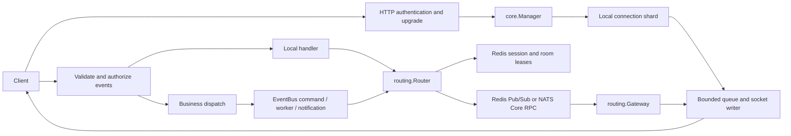

# WebSocket v2

WebSocket connections, bounded event execution and tenant-scoped realtime routing
for `github.com/thanhbvha/go-common/v2`. This repository requires Go 1.26.10 or
later. Import packages under `/v2/websocket`; there is no separate
`websocket/v2` Go module.

Use explicit instances: `core.NewManagerWithConfig`, `core.NewEventRegistry`, a
started `routing.Gateway`, and `routing.Router`. The core is framework independent;
adapters support net/http, Gin, Echo and Fiber. Global constructors and legacy
pub/sub remain available for existing applications.

Start with the [complete v2 example](../examples/websocket/v2/README.md): server,
scripted/listening client, Redis or NATS delivery, EventBus business dispatch,
user/session/room notifications, protected admin APIs and bounded shutdown. Its
tests exercise two gateways and separate tenants.

## Choose an integration

| Requirement | Integration |
|---|---|
| One process with local connections | Manager + adapter; no broker required |
| Target users, devices or rooms across nodes | Redis registry + Gateway + Router + Redis Pub/Sub or NATS Core delivery |
| Process business commands independently of connections | EventBus bridge, with Local or Business dispatch per event |
| Maintain an existing shard-based publication path | Legacy `websocket/pubsub`; do not also publish the same message through Router |
| Run the complete v2 flow | [v2 server and client](../examples/websocket/v2/README.md) |
| Split gateway/worker/router; mix Kafka/Redis/NATS | [cluster example](../examples/websocket/cluster/README.md) |
| Compare four HTTP adapters or generate load | [adapter examples](../examples/websocket/README.md), [load generator](../examples/websocket/loadtest) |

```bash
go get github.com/thanhbvha/go-common/v2
```

## Architecture and ownership



| Component | Responsibility | Ownership |
|---|---|---|
| `core.Manager` | Shards, connections, accounting, execution and supervision | Owns connections and internally created executor; borrows Gateway |
| `core.Connection` | One reader, one writer, bounded outbound queue, identity and rooms | Shard owns committed connection cleanup |
| `core.EventRegistry` | Validation, timeout, authorization/dispatch integration | Explicit instance per service/manager |
| `routing.Gateway` | Tenant/session/room indexes, leases, enqueue/dedupe | Start before Manager; close after Manager |
| `routing.Router` | Resolve locations, group destination nodes and inspect results | Uses a started transport; does not own broker clients |
| Redis registry | Session generations, TTLs and room membership | Borrows `redis.UniversalClient` |
| Delivery transport | Two node subscriptions and request/result correlation | Borrows Redis/NATS connection; close before that connection |
| EventBus bridge | Declare `ws.command` / `ws.notification`, publish and route work | Borrows Bus and Router; declare before Bus.Start |

An injected event executor is borrowed. Legacy pub/sub is closed only with
`PubSubOwnership: core.PubSubOwned`. Setting `ManagerConfig.Distributed` substitutes
a noop legacy pub/sub manager; use Router for cross-node traffic in that mode.

## Delivery contract

| Result | Meaning / application action |
|---|---|
| `Enqueued` | Outbound queue accepted the payload, or the gateway remembers acceptance for this message/session generation |
| `Offline` | No resolved recipients; no notification has been stored for later |
| `QueueFull` | Queue rejected this attempt; failed enqueue is not deduped as delivered |
| `Stale`, `NotFound` | Location generation changed or disappeared; Router re-resolves at most twice |
| `Unavailable` | Lease, gateway state or capacity prevents acceptance |
| `Unknown` | No usable reply; publication may already have caused enqueue |

Inspect **both** the error and `result.Retryable()`. Partial results may include
accepted and rejected recipients. Retry the same logical notification with the
**same message ID and payload**; never reuse an ID for an unrelated notification.

`Enqueued` is not a socket-write or client-receipt acknowledgement. Redis Pub/Sub
and NATS Core do not provide an offline inbox, replay or exactly-once delivery.
Persist durable application state and let clients resynchronize. EventBus
retry/durability belongs to its selected driver and does not make WebSocket
client delivery durable.

FIFO is the order of successful enqueue on each connection, not global ordering.
Local events run through a partitioned executor. A timed-out non-cooperative
handler may remain quarantined and overlap later work; handlers must obey context.

## Minimal single-process server

This complete example needs a server-issued credential in `WS_DEMO_TOKEN`.
It binds that credential to a trusted demo identity and exposes one ping event.
Replace the lookup with verified application authentication.

```go
package main

import (
    "context"
    "crypto/subtle"
    "errors"
    "log"
    "net/http"
    "os"
    "os/signal"
    "syscall"
    "time"

    wshttp "github.com/thanhbvha/go-common/v2/websocket/adapter/nethttp"
    "github.com/thanhbvha/go-common/v2/websocket/core"
    "github.com/thanhbvha/go-common/v2/websocket/limiter"
)

type pingPolicy struct{}
func (pingPolicy) CanSubscribe(context.Context, core.Identity, string) error {
    return core.ErrUnauthorized
}
func (pingPolicy) CanPublish(_ context.Context, i core.Identity, event string) error {
    if i.TenantID == "demo" && i.UserID == "alice" && event == "ping" { return nil }
    return core.ErrUnauthorized
}

func main() {
    token := os.Getenv("WS_DEMO_TOKEN")
    if len(token) < 32 { log.Fatal("set WS_DEMO_TOKEN to a credential of at least 32 bytes") }
    events := core.NewEventRegistry()
    events.Register("ping", core.HandlerConfig{
        Timeout: time.Second, MaxPayloadBytes: 128,
        Handler: func(_ context.Context, c *core.Connection, _ core.IncomingMessage) error {
            if !c.SendJSON(core.OutgoingMessage{Type: "pong", Data: "ok"}) { return core.ErrSendQueueFull }
            return nil
        },
    })
    cfg := core.DefaultManagerConfig()
    cfg.EventRegistry, cfg.Authorizer = events, pingPolicy{}
    cfg.Observer = &core.AtomicObserver{}
    cfg.MaxConnections, cfg.MaxConnectionsPerUser = 1000, 4
    if err := cfg.ValidateProduction(); err != nil { log.Fatal(err) }
    manager := core.NewManagerWithConfig(cfg)
    h := wshttp.NewHandler(wshttp.Config{
        Manager: manager,
        RateLimiter: limiter.NewRateLimiter(50, 100),
        ConnectionLimiter: limiter.NewConnectionLimiter(20),
        AuthenticateIdentity: func(r *http.Request) (core.Identity, error) {
            if subtle.ConstantTimeCompare([]byte(r.Header.Get("Authorization")), []byte("Bearer "+token)) != 1 {
                return core.Identity{}, core.ErrUnauthorized
            }
            return core.Identity{TenantID: "demo", UserID: "alice", ExpiresAt: time.Now().Add(time.Hour)}, nil
        },
    })
    mux := http.NewServeMux()
    mux.HandleFunc("GET /ws", h.HandleUpgrade)
    mux.HandleFunc("GET /readyz", func(w http.ResponseWriter, _ *http.Request) {
        if !manager.Readiness().Ready { w.WriteHeader(http.StatusServiceUnavailable) }
    })
    server := &http.Server{Addr: "127.0.0.1:8090", Handler: mux, ReadHeaderTimeout: 5*time.Second}
    failed := make(chan error, 1)
    go func() { failed <- server.ListenAndServe() }()
    ctx, stop := signal.NotifyContext(context.Background(), os.Interrupt, syscall.SIGTERM)
    defer stop()
    select {
    case <-ctx.Done():
    case err := <-failed:
        if !errors.Is(err, http.ErrServerClosed) { log.Print("HTTP listener stopped") }
    }
    httpCtx, cancelHTTP := context.WithTimeout(context.Background(), 5*time.Second)
    if err := server.Shutdown(httpCtx); err != nil { log.Print("HTTP shutdown incomplete") }
    cancelHTTP()
    wsCtx, cancelWS := context.WithTimeout(context.Background(), 6*time.Second)
    defer cancelWS()
    if err := manager.Shutdown(wsCtx); err != nil { log.Print("WebSocket drain incomplete") }
}
```

Send `{"type":"ping","data":{}}` using an authenticated client. Input is
`core.IncomingMessage{Type, Data}`; output is `core.OutgoingMessage{Type, Data,
RequestID}`. RequestID comes from server request context; core does not define a
per-message client correlation/ACK protocol.

## Adapters, identity and authorization

All adapters accept Manager, AuthenticateIdentity and upgrade/connection limiters.
Default authentication rejects upgrades; AuthenticateIdentity overrides legacy
Authenticate. Use the following callback and registration for each adapter:

| Adapter | Identity callback | Register upgrade |
|---|---|---|
| `adapter/nethttp` | `func(*http.Request) (core.Identity, error)` | `mux.HandleFunc("GET /ws", h.HandleUpgrade)` |
| `adapter/gin` | `func(*gin.Context) (core.Identity, error)` | `router.GET("/ws", h.HandleUpgrade)` |
| `adapter/echo` | `func(echo.Context) (core.Identity, error)` | `server.GET("/ws", h.HandleUpgrade)` |
| `adapter/fiber` | `func(*fiber.Ctx) (core.Identity, error)` | `app.Get("/ws", h.HandleUpgrade)` |

Net/http, Gin and Echo use Gorilla Upgrader; Fiber exposes CheckOrigin. Defaults
require same-origin when Origin is present, and permit clients with no Origin.
Cross-origin access needs an explicit allowlist; Origin is not authentication.
Trust proxy headers only behind configured trusted proxies.

Browser WebSocket cannot set an arbitrary Authorization header. Use verified
same-site cookies or a separately designed short-lived upgrade-ticket flow.
The example Go client uses a bearer header; it never puts credentials in URLs.

Build Identity (TenantID, UserID, AccountID, SessionID, ExpiresAt) from verified
server-side data. HTTP authentication, CanPublish and CanSubscribe are separate
checks. Validate and authorize payload targets too. `ValidateProduction` requires
an explicit non-nil authorizer, but cannot verify your business policy.

Distributed identities require tenant and user. With no SessionID, Manager creates
one per physical connection in distributed/business mode. A stable authenticated
SessionID identifies a device/login: registration replaces its location with a
fresh generation. Cross-node takeover closes the old owner when renewal detects
fencing, not synchronously across the cluster.

Local `Shard.SendToUser` / `SendToRoom` are shard scoped and use raw identifiers;
they are not tenant security boundaries. Namespace/authorize local IDs. Router
always takes an explicit tenant. Client-supplied identity/role/tenant fields are
not authentication or permission to select privileged routing targets.

## Distributed setup and sends

The built-in session registry requires Redis even with NATS delivery. NATS Core
delivery alone does not require JetStream. Keep broker TLS verification enabled
and load credentials from deployment configuration.

The following is startup wiring inside an application with `ctx` and a connected
Redis UniversalClient. Imports are `websocket/core`, `websocket/routing`,
`websocket/routing/redis` as `redisrouting`, and optionally `websocket/routing/nats`
as `natsrouting`. The [complete example](../examples/websocket/v2/app.go) also
handles startup rollback and explicit dependency shutdown.

```go
registry := redisrouting.NewRegistry(redisClient, "my-service")
delivery := redisrouting.NewTransport(redisClient, "my-service")
// Alternative: natsrouting.NewTransport(natsClient, "my-service")
gateway, err := routing.NewGateway(routing.GatewayConfig{
    Registry: registry, Transport: delivery, RegistryConcurrency: 32,
    LeaseTTL: 30*time.Second, RenewInterval: 10*time.Second,
    DedupeTTL: time.Minute, DedupeCapacity: 100000, MaxPayloadBytes: 16*1024,
})
if err != nil { return err }
if err := gateway.Start(ctx); err != nil { return err }
router, err := routing.NewRouter(routing.RouterConfig{
    Registry: registry, Transport: delivery, Timeout: 3*time.Second, MaxPayloadBytes: 16*1024,
})
if err != nil { return err }
cfg := core.DefaultManagerConfig()
cfg.Distributed, cfg.EventRegistry, cfg.Authorizer = gateway, applicationEvents, applicationPolicy
if err := cfg.ValidateProduction(); err != nil { return err }
manager := core.NewManagerWithConfig(cfg)
```

Router-only processes start delivery with
`delivery.Start(startupCtx, routing.NewID(), nil)`. NodeID defaults to a UUID;
custom IDs must be unique per process incarnation, including rolling restarts.

```go
id := routing.NewID() // Persist/reuse this ID for retries of this logical send.
result, err := router.SendToUser(ctx, tenant, user, payload, id)
// Or: router.SendToSession(ctx, tenant, user, session, payload, id)
// Or: router.SendToRoom(ctx, tenant, room, payload, id)
if err != nil || result.Retryable() {
    // Keep partial outcomes; apply the application's bounded retry policy.
}
accepted := result.Count(routing.Enqueued)
_ = accepted
```

Rooms fan out once per hosting node, across that node's shards. Room results have
compact node/status Outcomes and recipient Counts: Outcomes length is not audience
size. Each send uses at most 32 destination workers. Transport permits 1,024
pending requests and caps encoded envelopes at 2 MiB. The raw payload default is
1 MiB; broker limits must also fit JSON/base64 and envelope overhead.

## Event handlers and EventBus

Register events on an explicit registry before constructing Manager:

```go
events.Register("chat.send", core.HandlerConfig{
    Dispatch: core.Local, Timeout: 2*time.Second, MaxPayloadBytes: 2048,
    Validate: validateChatPayload,
    Handler: func(ctx context.Context, c *core.Connection, m core.IncomingMessage) error {
        return handleChat(ctx, c, m) // Authorize the payload's room/target here.
    },
})
events.Register("business.echo", core.HandlerConfig{
    Dispatch: core.Business, Timeout: 3*time.Second,
    MaxPayloadBytes: 2048, Validate: validateBusinessPayload,
})
```

Local is the default. Business dispatch publishes a validated command through
ManagerConfig.CommandPublisher. Once EventBus accepts a task, the connection does
not own its processing lifetime. The example uses strict JSON decoding and
`web/validator.Validate`. Malformed, unknown, unauthorized and rejected events are
counted. Core does not automatically send validation/handler error frames; define
that behavior in the application protocol.

Before Bus.Start, create `websocket/integration/eventbus.New` with the borrowed
Bus and Router, register a `ws.command` task handler and wire CommandPublisher.
The bridge declares `ws.command` and `ws.notification`. Router instances share
subscriber group `realtime-router`. Redis/NATS EventBus need the driver's
`WithEventLayoutTargeted()` notification topology option. See the complete
[bridge wiring and worker](../examples/websocket/v2/app.go).

Workers decode BusinessCommand, perform idempotent work and publish Notification
with a stable ID. Offline is terminal success; unknown/queue-full/partial results
can trigger EventBus retry/DLQ. The bridge does not own Bus.Start/Drain/Close.
Database atomicity, outbox/inbox and business idempotency belong to the application.
For Kafka EventBus and explicit publication dedupe policy, see the
[cluster example](../examples/websocket/cluster/README.md).

## Configuration reference

Start from `core.DefaultManagerConfig()`. Most nonpositive core limits normalize
to defaults rather than disabling the feature.

| Core field | Default | Scope |
|---|---:|---|
| MaxConnections / MaxShards / MaxShardConnections | 200000 / 1000 / 100000 | Node-local admission; shard count includes default shard |
| SendQueueSize / InboundQueueSize | 256 / 4096 | Messages per connection / events per shard |
| BroadcastQueueSize | 4096 | Compatibility field; synchronous broadcast does not use this queue |
| ExecutorPartitions / ExecutorQueueSize | CPU count / 256 | Partitions and pending tasks per partition |
| MaxHandlerGoroutines / MaxPendingHandlers | CPU count × 4 / 64 | Supervised handlers per manager / pending work per connection |
| MaxMessageBytes | 1024 | Inbound frame bytes; independent of Router outbound payload bound |
| MessagesPerSecond / MessageBurst | 100 / 200 | Per-connection message bucket |
| BytesPerSecond / ByteBurst | 65536 / 131072 | Per-connection inbound byte bucket |
| MaxRoomsPerConnection | 100 | Connection room quota |
| SlowConsumerDropThreshold | 1 | Consecutive queue drops before disconnect |
| MaxConnectionsPerUser/Account/Tenant | 0 | Optional node-local quotas; zero leaves a dimension unlimited |
| WriteWait / PongWait / PingPeriod | 10s / 60s / 54s | Write deadline / pong-based read deadline / ping interval |
| DrainTimeout | 5s | Shared outbound drain budget across manager shards |
| DisableLifecycleLogging | false | Suppress lifecycle logs; set privacy policy for other logs separately |

Admission includes active plus reserved connections. Quotas are node-local, not
cluster-global. Quota dimensions use raw Identity user/account/tenant values;
tenant-local user/account IDs may share a quota unless the application uses
globally unique identifiers. Redis registry defaults to 1,000 sessions per tenant/user; configure
WithMaxSessionsPerUser deliberately alongside app quotas. Queues are bounded by
item count, not total outbound bytes. Account for payloads, socket/TLS buffers,
handlers and slow clients when sizing them.

| Gateway / Router field | Default | Behavior |
|---|---:|---|
| Gateway LeaseTTL / RenewInterval | 30s / TTL ÷ 3 | Interval must be positive and below TTL |
| Gateway RegistryConcurrency | 32 | Bound simultaneous registry operations |
| Gateway DedupeTTL / DedupeCapacity | 1 minute / 100000 | Bounded, process-local; restart/expiry/eviction allow duplicates |
| Gateway MaxPayloadBytes | 1 MiB | Raw targeted payload bound |
| Router Timeout / MaxPayloadBytes | 5s / 1 MiB | Send deadline and raw payload bound |

## Coordination and room indexing

Lifecycle operations are ordered per logical session. Gate/permit waits observe
cancellation; registry I/O never holds the shared index mutex. Remove detaches
local state before broker work. Renewal processes idle sessions in batches of at
most 256 and stays ordered with remove/leave. Busy sessions are skipped; expired
observed session leases reject delivery. Legacy ownership lookups do not prove
successful lease extension.

Delivery snapshots recipients under the index lock, then enqueues with a separate
per-session gate. Dedupe has up to 64 bounded stripes; hash skew can evict entries
before total capacity is reached. Slow-consumer network close runs separately.
Unrelated sessions can progress; a single hot session still serializes.

Redis generations fence delayed cleanup. Lua keys share a tenant hash slot; one
hot tenant still occupies one Redis Cluster slot. Default room reads aggregate
node IDs in Redis but still scan legacy memberships on the server. New writers
also maintain room-node leases.

WithRoomNodeIndex enables reads proportional to hosting nodes. Enable only after
all writers support the index and old memberships expire or refresh. Keep
compatibility reads during mixed-version rollout; disable indexed reads before
rolling writers back. The index adds writes and metadata; follow the
[detailed rollout guide](routing/README.md#room-lookup-and-node-index-rollout).

## Shutdown and drain

Manager lifecycle is `Starting → Running → Draining → Stopped`. Shutdown rejects
new connections, detaches shard maps, stops outbound admission, flushes accepted
messages in FIFO order, then closes sockets. The first caller context and
DrainTimeout bound outbound drain across shards. Expiry forces close; another
Shutdown call does not erase retained drain failures. ErrDrainIncomplete means
accepted messages could not all be written.

Connection.Drain flushes its outbound queue and can start pumps in the registration
window before Run. It does not finish business work or acknowledge client receipt.
Close is idempotent and does not wait for pumps, but calls underlying network Close.
Wait(ctx) waits for lifecycle completion after Run. A canceled wait does not prove
that a callback/driver which ignores cancellation has stopped.

For borrowed dependencies, use this order:

1. Mark readiness false; stop HTTP upgrades and business publication from existing sockets.
2. Drain accepted business work and notification consumers while routing and sockets remain available. Broker backlog/offline replay need application policy.
3. Call Manager.Shutdown with a fresh bounded context to flush outbound queues.
4. Close Gateway and any separate router transport, each with a fresh context.
5. Release broker clients after their borrowers stop; retain/report cleanup failures.

HTTP shutdown does not close hijacked WebSocket connections. Use fresh cleanup
contexts rather than an already canceled signal context. Gateway.Close closes
operation admission, cancels/joins in-flight work and renewal, compensates late
registration commits, then closes transport. If it times out, retry with a fresh
budget before releasing clients. Closing Gateway alone does not close sockets.

Unregister is best-effort with bounded retries and generation fencing; lease expiry
is outage fallback. DrainTimeout bounds outbound work, not arbitrary user code or
an injected executor/driver that ignores cancellation.

## Operations and verification

Manager.Readiness checks lifecycle, executor, broker and accounting. GetStats
exposes connections, event/executor/supervisor counters, inbound/outbound outcomes
and event/queue latency buckets. Protect stats and management endpoints with
application admin authorization; adapters do not supply that authorization.

AtomicObserver implements optional DrainObserver and exposes connectionsDrained,
drainForced and drainDiscarded (messages unwritten at cutoff). Gateway reports
sessions, rooms, dedupe entries, lease failures, enqueues/rejections and unregister
failures/retries. Router reports attempts, unknowns, partials and stale retries.
Avoid identity/payload labels and credential-bearing log fields.

Run from the repository root:

```bash
go test ./websocket/... ./examples/websocket/...
go vet ./websocket/... ./examples/websocket/...
go test -race -count=10 ./websocket/core ./websocket/pool ./websocket/pubsub/... ./websocket/adapter/... ./websocket/routing/... ./examples/websocket/v2/...
```

Tagged live pub/sub tests require Redis localhost:6379 and NATS localhost:4222.
The v2 example Compose file deliberately uses different host ports.

```bash
WS_REDIS_INTEGRATION=1 WS_NATS_INTEGRATION=1 go test -tags=integration -count=1 ./websocket/pubsub/redis ./websocket/pubsub/nats
```

See [benchmarks and profiling](BENCHMARKS.md), the
[gateway comparison](benchmarks/gateway-drain-20261103.md),
[routing details](routing/README.md), and the
[production matrix](../docs/PRODUCTION.md). Synthetic fan-out measurements are not
broker rankings or capacity claims. Include hot users, TLS, payload size, node
count, slow consumers and reconnect churn in deployment tests.
