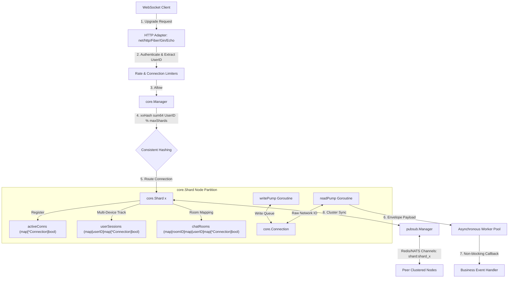

# websocket

A high-performance, framework-agnostic, and clustered WebSocket library with support for parallel Shard sharding, asynchronous worker pools, token-bucket rate limiting, and Redis Pub/Sub cluster routing.

Includes dedicated adapters for popular Go web frameworks:
- **Standard Library Adapter (`websocket/adapter/nethttp`)**
- **Fiber Adapter (`websocket/adapter/fiber`)**
- **Gin Adapter (`websocket/adapter/gin`)**
- **Echo Adapter (`websocket/adapter/echo`)**

### Core Concepts

1. **Framework-Agnostic Core (`core.Conn`):** All connections are abstracted through the `core.Conn` interface, which wraps standard `gorilla/websocket` or any custom engine.
2. **Actor-like Shard Sharding:** Connections are dynamically distributed across multiple parallel `Shard` instances using a consistent xxHash algorithm on the `userID`. Each Shard runs its own isolated message-select loop to prevent CPU lock contention.
3. **Asynchronous Processing:** Heavy computations and event handlers are offloaded to an asynchronous Goroutine worker pool, ensuring the connection's network reader is never blocked.
4. **Zero-Dependency Standalone Fallback:** If you do not explicitly inject a Pub/Sub manager (e.g., Redis or NATS) via Dependency Injection, the clustered coordination engine seamlessly defaults to a local in-memory loopback mode.
### Architecture & Flows

The library utilizes a highly parallel, sharded architecture that isolates state to prevent CPU lock contention and scales horizontally across multiple nodes via Redis Pub/Sub.



#### Detailed Workflows

##### A. Connection Upgrade & Shard Routing
1. A client initiates a standard WebSocket handshake at `/ws?user_id=123` and supplies its credential through the application's normal authentication mechanism, such as an `Authorization: Bearer ...` header or a secure session cookie.
2. The HTTP adapter (**net/http**, **Fiber**, **Gin**, or **Echo**) verifies the handshake, authenticates the request, and checks rate limits and concurrent IP limits.
3. The adapter extracts the logical `userID` (e.g. `user_123`) and requests a shard assignment from the **`core.Manager`**.
4. The `Manager` performs a consistent hashing routing operation:
   $$\text{ShardIndex} = \text{xxHash.Sum64String}(\text{userID}) \pmod{\text{maxShards}}$$
5. The connection is upgrade-wrapped and registered to the corresponding **`core.Shard`**. The shard handles multi-device management automatically inside `userSessions`.

##### B. Parallel Message Pump & Event Loop
*   **`readPump` (1 per connection):** Reads raw messages from the client network socket. Upon receiving a frame, it encapsulates the bytes into an `EventMessage` and passes it to the shard's incoming message queue.
*   **Asynchronous Worker Pool:** The event dispatcher takes messages from the shard queue and submits them to a thread-safe, pre-allocated **Goroutine Worker Pool** (`pool.GetGlobalPool()`). This keeps the `readPump` completely free from heavy computational logic blocking.
*   **`writePump` (1 per connection):** Listens to a dedicated thread-safe send channel (`chan []byte`) with batch optimization. It groups multiple queued messages together before writing to the network socket, minimizing system calls.

##### C. Clustered Redis Pub/Sub Synchronization
*   When a node broadcasts a message or target event globally (e.g., `Shard.BroadcastGlobal` or `Shard.BroadcastRoomMessage`), it routes the event to its local active connections and packages the payload into a `CrossNodeMessage`.
*   The payload is published to the Pub/Sub broker (Redis or NATS) via **`pubsub.Manager`** over the dedicated shard channel: `shard:<shard_name>`.
*   Clustered peer instances subscribing to `shard:<shard_name>` receive the event, deserialize the envelope, and feed it into their local shard event loop, reaching target clients globally in sub-millisecond times.

### Usage Example

```go
import (
	"github.com/thanhbvha/go-common/websocket/core"
	wsNetHTTP "github.com/thanhbvha/go-common/websocket/adapter/nethttp"
	wsFiber "github.com/thanhbvha/go-common/websocket/adapter/fiber"
	wsGin "github.com/thanhbvha/go-common/websocket/adapter/gin"
	wsEcho "github.com/thanhbvha/go-common/websocket/adapter/echo"
	"github.com/thanhbvha/go-common/websocket/pubsub"
	redispubsub "github.com/thanhbvha/go-common/websocket/pubsub/redis"
)

func main() {
	// 1. (Optional) Inject a distributed Pub/Sub backend for clustered mode
	// rdb := redis.NewClient(...) 
	// pubsub.SetGlobalManager(redispubsub.NewManagerWithClient(rdb))

	// 2. Register Custom Event Handlers
	core.RegisterHandler("chat_message", func(conn *core.Connection, msg core.IncomingMessage) error {
		// Process message asynchronously in worker pool
		conn.SendJSON(core.OutgoingMessage{
			Type: "chat_echo",
			Data: map[string]interface{}{"payload": string(msg.Data)},
		})
		return nil
	})

	// 3. Instantiate an adapter with an explicit authenticator.
	// The default authenticator rejects all upgrades.

	// Standard net/http Adapter Setup
	httpHandler := wsNetHTTP.NewHandler(wsNetHTTP.Config{
		Authenticate: func(r *http.Request) (string, error) {
			return validateToken(r.Header.Get("Authorization"))
		},
	})
	mux := http.NewServeMux()
	mux.HandleFunc("/ws", httpHandler.HandleUpgrade)

	// A. Fiber Adapter Setup
	fiberHandler := wsFiber.NewHandler(wsFiber.Config{Authenticate: authenticateFiber})
	fiberServer := wsFiber.NewServer(8080, fiberHandler)
	fiberServer.SetupRoutes()
	go fiberServer.Start()

	// B. Gin Adapter Setup
	ginHandler := wsGin.NewHandler(wsGin.Config{Authenticate: authenticateGin})
	r := gin.Default()
	r.GET("/ws", ginHandler.HandleUpgrade)

	// C. Echo Adapter Setup
	echoHandler := wsEcho.NewHandler(wsEcho.Config{Authenticate: authenticateEcho})
	e := echo.New()
	e.GET("/ws", echoHandler.HandleUpgrade)
}
```

### Security defaults

- An explicit `Authenticate` callback is required. Without one, upgrade requests are rejected; query parameters are never treated as authenticated identities automatically.
- The standard-library, Gin, Echo, and Fiber adapters default to same-origin browser connections. For intentional cross-origin use, supply a strict allowlist through Gorilla's `Upgrader.CheckOrigin` or Fiber's `Config.CheckOrigin`.
- The Fiber server does not trust proxy headers by default. Configure `TrustedProxies`, `EnableTrustedProxyCheck`, and `ProxyHeader` explicitly when deploying behind known proxies.
- Every adapter exposes `Config.ConnectionKey`. Use it to select a direct peer,
  a framework IP resolved through an explicit trusted-proxy policy, or an
  authenticated account key for concurrent connection limits.
- Operational handlers such as `HandleStats` and `HandleShardManagement` are not registered by `fiber.Server.SetupRoutes`. Register them explicitly behind application administrator authorization. The Gin, Echo, and `net/http` examples also omit these routes by default.
- Health output includes runtime topology metadata. Expose it only on an internal listener or protect it when that metadata is sensitive.

### Panic recovery

Wrap the HTTP upgrade routes with the matching recovery middleware from `web/middleware/nethttp`, `web/middleware/fiber`, `web/middleware/gin`, or `web/middleware/echo`. These middlewares return a safe HTTP 500 response and record a structured panic report before the WebSocket handshake is committed.

After a successful upgrade, framework middleware cannot recover panics from the connection goroutine. Each adapter and the core read/write pumps therefore use the framework-independent `recovery` package directly. These recovery boundaries log the panic type and message, origin file/line/function, bounded stack trace, and available connection metadata, then perform connection cleanup. Panic diagnostics are never sent to the WebSocket peer.

Runtime event, shard, worker, Redis, and NATS boundaries use the same structured
recovery path. Logs contain correlation and routing metadata but never include
WebSocket frames or pub/sub payload data.

| Boundary | Panic policy | Cleanup / continuation |
|---|---|---|
| HTTP upgrade | Return safe HTTP 500 | Request ends before upgrade |
| Adapter connection | Stop connection goroutine | Close socket and release connection-limit slot |
| Core read/write pump | Stop failed pump | Unregister or close the connection |
| Business event handler | Discard failed invocation | Future events continue; no automatic retry |
| Worker task | Discard failed task | Worker remains available for later tasks |
| Shard run loop | Discard the consumed operation | Restart loop unless shard context is canceled |
| Shard cleanup pass | Abort failed pass | Next scheduled cleanup still runs |
| Redis listener | Stop failed listener | Remove and close its subscription so explicit resubscribe can succeed |
| Redis/NATS message handler | Discard failed invocation | Subscription and future messages continue |
| Redis/NATS loopback handler | Discard failed invocation | Standalone mode continues |

Shard operations are not replayed after panic. Applications requiring retries
must implement idempotency and retry semantics at the business-message layer.
Redis and NATS default clients are discovered through non-panicking
`LookupDefault` accessors; absence selects standalone loopback mode.

### Key types

| Symbol | Description |
|---|---|
| `core.Conn` | WebSocket connection abstraction interface |
| `core.Connection` | Active thread-safe client session (with read/write pumps) |
| `core.Shard` | Parallel communication channel (room & group routers) |
| `core.Manager` | Process-wide websocket registry & sharding distributor |
| `pubsub.Manager` | Abstract clustered message router interface |
| `redispubsub.Manager` / `natspubsub.Manager` | Concrete Redis or NATS PubSub backends |
| `limiter.RateLimiter` | Generic token-bucket rate throttler |
